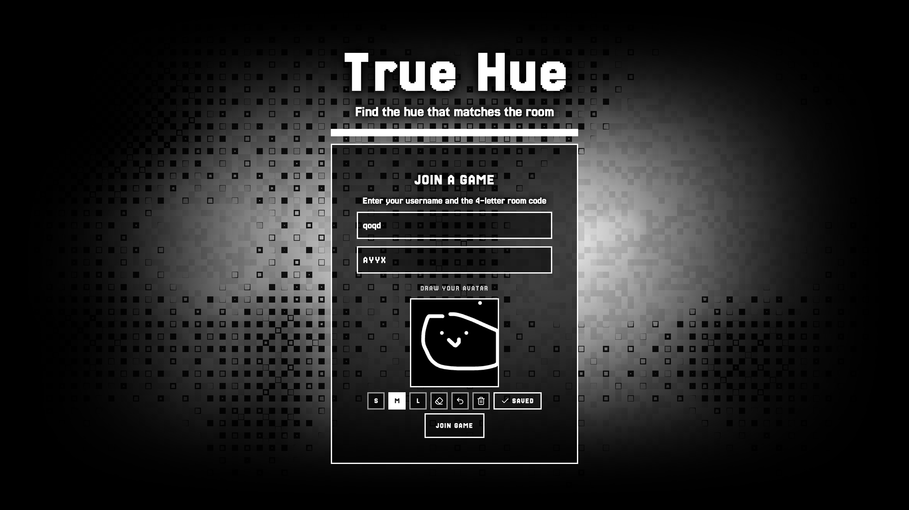
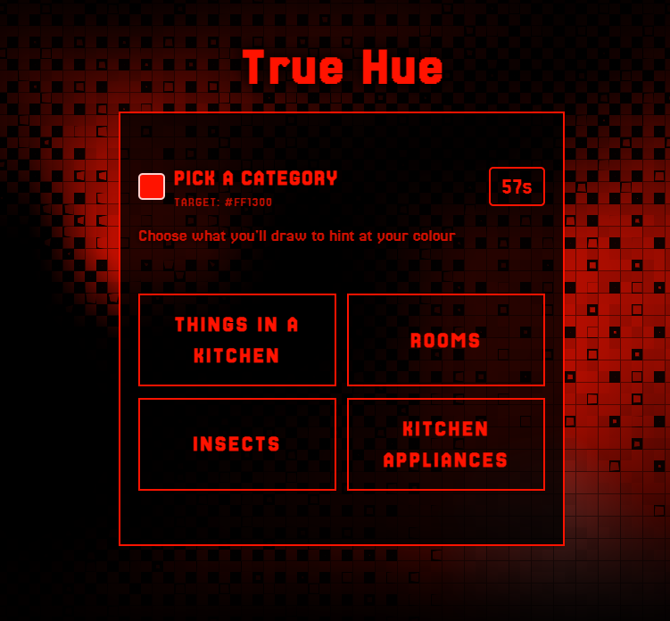
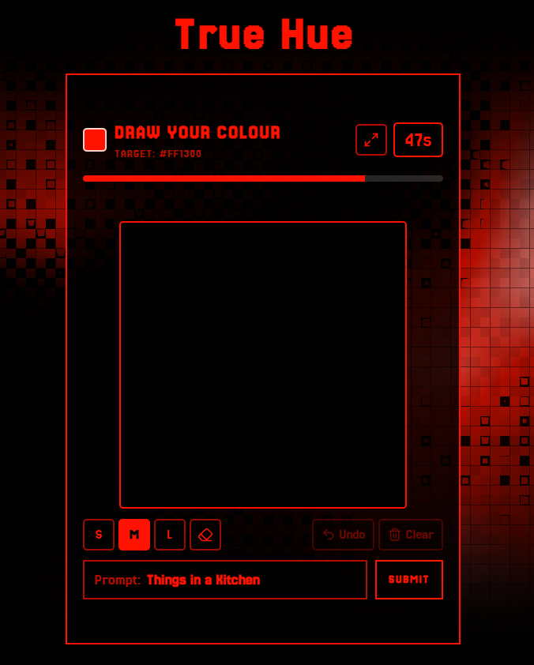
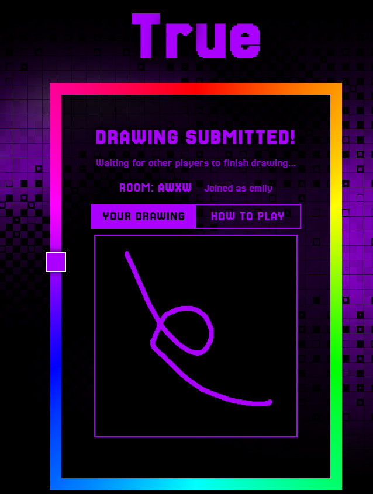
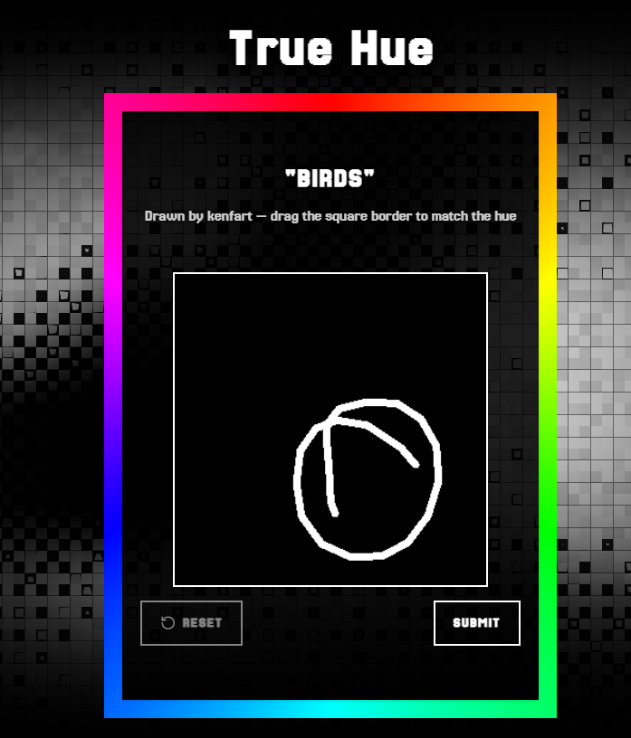
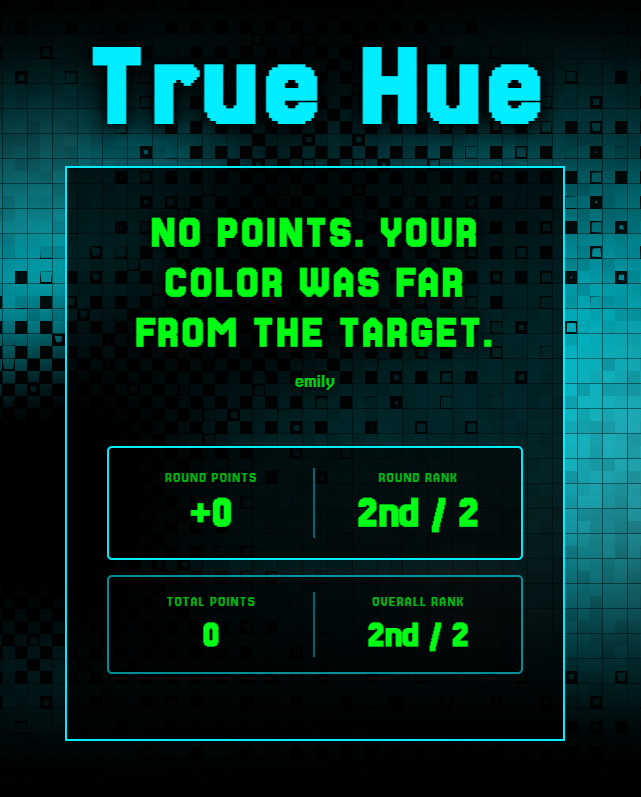
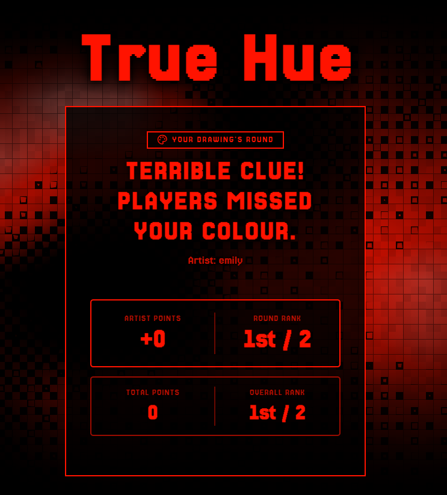
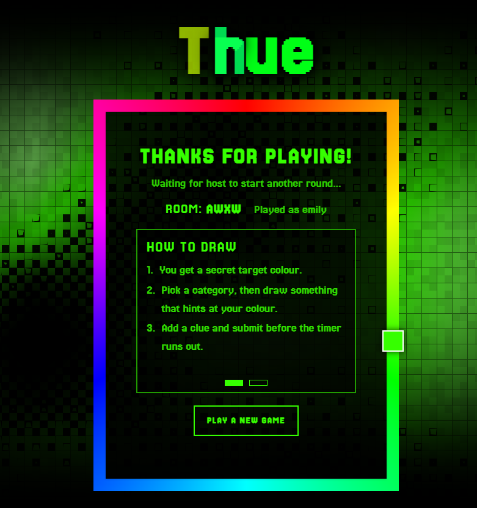

# True Hue

**Find the hue that matches the room.**

True Hue is a party game about colour. Everyone plays on their phone, and a laptop or TV acts as
the shared big screen. Each artist gets a secret target colour and has to draw something that hints
at it. Everyone else then studies the drawing and drags a hue slider to guess the colour. The
closer you get, the more points you score.

Built for CodeJam 2026 by:

| Who | Part | Folder |
|---|---|---|
| **Kenneth** | Game host: the big-screen game, phases, scoring and visuals (Unity) | [`CodejamBackend/`](CodejamBackend/) |
| **Harry** | Relay server that connects the host and the phones (Node.js WebSocket) | [`relay/`](relay/) |
| **Emily** | Player app that runs on the phones (React) | [`frontend/`](frontend/) |

---

## Contents

- [How to play](#how-to-play)
- [Screenshots](#screenshots)
- [Architecture](#architecture)
- [Repository layout](#repository-layout)
- [Running it locally](#running-it-locally)
- [Deployment](#deployment)
- [Component details](#component-details)
  - [Unity host (`CodejamBackend/`)](#unity-host-codejambackend)
  - [Relay (`relay/`)](#relay-relay)
  - [Phone app (`frontend/`)](#phone-app-frontend)
- [Scoring](#scoring)
- [Limits](#limits)
- [Further reading](#further-reading)

---

## How to play

1. **Host a game.** Open the Unity game on the big screen and create a game. You can set the
   drawing time, the guessing time and how many players draw. The screen shows a 4-letter
   **room code** and a **QR code**.
2. **Join on your phone.** Scan the QR code, or open the site and type the room code. Pick a
   username (up to 16 characters) and draw a small avatar. Up to **32 players** per room.
3. **Draw.** Some of the players are chosen as **artists**. Each artist gets a **secret target
   colour** and picks one of four **categories**, such as "Things in a Kitchen" or "Insects".
   They then draw something from that category that hints at their colour, for example a
   tomato for red or a leaf for green. Drawings are only in black and white, so the hint has to
   come from *what* you draw.
4. **Guess.** The drawings are shown one at a time with their category. Everyone except the
   artist drags the square hue slider to the colour they think it is, then submits.
5. **Reveal.** All guesses burst into coloured cubes on the big screen and merge into the
   room's combined colour, which is shown next to the **true hue**. Guessers score for how close
   they were. The artist scores for how well their drawing led people to the right colour.
6. **Leaderboard.** After every drawing has been guessed, final rankings are shown. The host can
   start another game in the same room.

## Screenshots

Phone app:

| Join | Pick a category | Draw |
|---|---|---|
|  |  |  |

| Waiting for others | Guess the hue | Guesser result |
|---|---|---|
|  |  |  |

| Artist result | Game over |
|---|---|
|  |  |

## Architecture

```
 ┌──────────────────────┐          ┌──────────────────────┐          ┌──────────────────────┐
 │  Phones (React app)  │  wss://  │        Relay         │  wss://  │  Unity host          │
 │  frontend/           │ ───────► │  relay/              │ ◄─────── │  CodejamBackend/     │
 │  Cloudflare Pages    │          │  Railway (Node.js)   │          │  big-screen laptop   │
 └──────────────────────┘          └──────────────────────┘          └──────────────────────┘
   draw, pick, guess                 rooms, seats, routing              game logic, timers,
                                     (never reads game data)            colours, scoring
```

The **Unity host runs the game**. It owns the phases, timers, target colours, the word bank and
all scoring.

The **relay** only moves messages around. It creates rooms, keeps track of who is in each one,
handles reconnects and forwards messages. It never looks inside game messages. It only decides
who is allowed to send to whom. Players can only send to the host and can't message each other,
so nobody can read another player's secret colour.

The **phone app** is a thin client. It shows whatever phase the host says the game is in and
sends the player's actions back to the host.

A typical round over the wire:

```
Host  ──► all players   drawing phase starts; each artist gets a target + 4 categories
Phone ──► host          category_pick, then the finished drawing (gzipped 1-bit bitmap)
Host  ──► each guesser  the next drawing + its category + time remaining
Phone ──► host          hue guess
Host  ──► each player   round result: points, round rank, overall rank
```

The full message format is in [relay/PROTOCOL.md](relay/PROTOCOL.md).

### Reconnects

Phones lose connection all the time: screens lock, users switch apps, wifi drops. The game is
built to recover:

- A phone that drops has **30 s** to come back and gets **the same seat** (same player ID, name and
  score). If it returns mid-round, the host sends it the current phase so it catches up.
- If the host drops, the room is kept for **60 s** so the host can reconnect with its secret host key.
  Phones show a "host lost" state until then.
- Opening the game in a second tab replaces the first tab instead of creating a duplicate player.

## Repository layout

```
Codejam2026/
├── CodejamBackend/        Unity project (the host / big screen)       — Kenneth
│   ├── Assets/Scenes/     Menu, GameScene, LayoutTest
│   └── Assets/Scripts/    GameManager, scoring, word bank, networking, UI
├── relay/                 WebSocket relay server                      — Harry
│   ├── src/               server, rooms, routing, protocol parser
│   ├── test/              unit and real-socket tests
│   ├── scripts/           fake host/player CLIs for testing without Unity or React
│   └── PROTOCOL.md        wire protocol: the contract between all three parts
├── frontend/              React phone app                             — Emily
│   └── src/               pages, components, relay client, drawing codec
└── docs/screenshots/      images used in this README
```

## Running it locally

You need:

| Tool | Version | For |
|---|---|---|
| Node.js | **22.18+** | relay and frontend |
| Unity | **6000.3.24f1** (Unity 6) | host game |

Each part can run on its own, so you only need to start what you're working on.

### 1. Relay

```bash
cd relay
npm install
npm run dev            # ws://localhost:8080, restarts on save
```

Check it at <http://localhost:8080/healthz>.

### 2. Phone app

```bash
cd frontend
npm install
cp .env.example .env.local   # VITE_RELAY_URL=ws://localhost:8080/ by default
npm run dev                  # http://localhost:5173
```

To test on a real phone, open the Vite **network** URL (e.g. `http://192.168.x.x:5173`) on a phone
connected to the same wifi. Set `VITE_RELAY_URL` to `ws://<your-laptop-ip>:8080/`.

To click through the UI with no relay or host running, set `VITE_DEV_MOCK=true` in `.env.local`.

### 3. Unity host

1. Open `CodejamBackend/` in Unity Hub with editor **6000.3.24f1**.
2. Open `Assets/Scenes/Menu.unity` and press **Play**.
3. Set the relay URL on the `RelayClient` component: `ws://localhost:8080` for a local relay, or
   the deployed `wss://` URL.

### Without Unity or the phone app

The relay includes command-line clients that act as a fake host or player:

```bash
cd relay
npm run host                    # prints a room code
npm run player -- ABCD Harry    # joins room ABCD as "Harry"
```

Type `help` in either terminal to see the commands. See [relay/README.md](relay/README.md#try-it-without-unity-or-react).

## Deployment

| Part | Where | How it updates |
|---|---|---|
| Relay | Railway: `wss://truehue-production.up.railway.app` | `railway up` from `relay/` (pushing to GitHub does **not** redeploy it) |
| Phone app | Cloudflare Pages, project root `frontend/` | Automatically on push to `main` |
| Unity host | Runs in the editor or as a build on the demo laptop | n/a |

The frontend needs the build variable `VITE_RELAY_URL=wss://truehue-production.up.railway.app`.
In production, the relay's `ALLOWED_ORIGINS` must include the Pages domain, otherwise phones are
rejected with close code `1008`.

> Every relay redeploy closes all open rooms, so **don't redeploy during a game**.

Full steps: [relay/README.md → Deploying](relay/README.md#deploying).

## Component details

### Unity host (`CodejamBackend/`)

Built with Unity 6 and URP. Packages used: NativeWebSocket (relay connection), Newtonsoft JSON,
PrimeTween (animation), Alchemy (inspector) and Serialized Collections.

| Script | Job |
|---|---|
| `GameManager.cs` | Phase state machine: `Drawing → ArtistReveal → Guessing → MergeReveal → … → Finished`. Owns timers, picks artists, collects drawings and guesses. Waits for disconnected phones for at most a few seconds. |
| `HueScoring.cs` | Points for guesses and artists (see [Scoring](#scoring)). |
| `CategoryWordBank.cs` | Drawing categories. Each artist is offered 4. Players can also suggest a category in the lobby, which goes to a different artist. |
| `RevealController.cs`, `ColorPhysics.cs`, `ColorOverlapBlender.cs`, `ColorPartitionService.cs` | The cube burst-and-merge reveal: each guess turns into physics cubes that blend into the room's combined colour. The number of cubes on screen is capped. |
| `Networking/HostRelayClient.cs`, `RelayClient.cs` | Talks to the relay: creates or resumes the room, sends phase updates and catch-up state to phones. |
| `Networking/DrawingImageCodec.cs` | Decodes the phones' gzipped 1-bit drawing bitmaps into textures. |
| `UI/*` | Menu and create-game settings, QR code, drawing and guessing screens, player ring layout, leaderboard, background effects. |

Scenes: `Menu` (create game, lobby and QR code), `GameScene` (the match), `LayoutTest` (preview
the layout with many fake players).

Most tuning values are on the `GameManager` component in the inspector: drawing time (default
60 s), guessing time (30 s), artist count (4), reveal and leaderboard durations, and the cube
limits. The menu's Create Game screen overrides the first three.

### Relay (`relay/`)

Node.js 22.18+ and TypeScript, run directly by Node with no build step. Its only dependency is
[`ws`](https://github.com/websockets/ws).

- **Rooms:** 4-letter codes without easily confused letters (no `I`, `L`, `O`). Codes are
  case-insensitive.
- **Routing rules:** the host can send to everyone, all players or one player. Players can send
  only to the host. The relay always sets the sender itself, so nobody can pretend to be the
  host or another player.
- **Reliability:** heartbeats detect dead sockets, and seats are held for a grace period after a
  disconnect. Idle rooms are cleaned up, and the server shuts down cleanly on redeploy.
- **Abuse limits:** 64 KB message cap, per-socket rate limit, origin allow-list, and every
  incoming message is validated. A crash in one message handler can't take the server down.
- **Tests:** about 130 tests, including real-socket tests that each start their own relay.

```bash
cd relay
npm run typecheck && npm test
```

More detail, including configuration, logs and how each file fits in: [relay/README.md](relay/README.md).

### Phone app (`frontend/`)

React 19, Vite, TypeScript, Tailwind CSS 4, shadcn/Base UI, Motion and Zustand.

| Path | Job |
|---|---|
| `src/Pages/LoginPage.tsx` | Join screen: name, room code (pre-filled from `?room=` in the QR link), avatar drawing |
| `src/Pages/PlayPage.tsx` | All in-game screens, driven by the phase the host sends |
| `src/components/CategoryPickerCard.tsx` | Pick one of the four categories |
| `src/components/DrawingCanvasCard.tsx` | Drawing canvas: brush sizes, eraser, undo, clear, fullscreen, auto-submit when time runs out |
| `src/components/SquareHueSlider.tsx` | The square hue slider used to guess |
| `src/components/RoundResultsCard.tsx` | Score cards for guessers and artists |
| `src/lib/relayClient.ts` | WebSocket connection, automatic reconnect and rejoin, dev mock |
| `src/lib/drawingCodec.ts` | Encodes drawings as gzipped 1-bit bitmaps so they fit in one message |
| `src/lib/protocol.ts` | Message types shared with the relay (mirrors `relay/PROTOCOL.md`) |

The page's theme changes to match the current colour: the player's target colour while drawing,
and their guess while guessing.

Useful URL parameters:

| Parameter | Effect |
|---|---|
| `?room=ABCD` | Pre-fills the room code. The Unity QR code uses this. |
| `?ws=wss://…` | Use a different relay for this tab, e.g. a backup tunnel. `?ws=` clears it. |

```bash
cd frontend
npm run lint
npm run build
```

## Scoring

Colour distance is measured with **CIEDE2000 (ΔE)**, the standard measure of how different two
colours look to a person. ΔE ≈ 1 is barely noticeable, ≈ 5 is close, and 35 or more scores nothing.

| Part | Rule |
|---|---|
| Base | `max(0, 1000 × (1 − ΔE / 35))` |
| Speed | ×1.5 for an instant guess, falling to ×1.0 at the end of the guessing time |
| Streak | +100 for each guess in a row with ΔE ≤ 10 after the first (2nd in a row +100, 3rd +200, …) |
| Artist | The average of the points their drawing earned from the players who guessed it |

The implementation is in `CodejamBackend/Assets/Scripts/HueScoring.cs`.

## Limits

| Limit | Value | Set in |
|---|---|---|
| Players per room | 32 | `relay/src/protocol.ts` and `frontend/src/lib/protocol.ts` (`MAX_PLAYERS`) |
| Username length | 16 characters | `NAME_MAX_LENGTH`, same files |
| Category suggestion length | 24 characters | `frontend/src/lib/protocol.ts` |
| Message size | 64 KB | `relay/src/config.ts` |
| Rate limit | 40 messages/s per socket (burst 100) | `relay/src/config.ts` |
| Player reconnect grace | 30 s | `relay/src/config.ts` |
| Host reconnect grace | 60 s | `relay/src/config.ts` |

If you change `MAX_PLAYERS`, change it in both the relay and the frontend.

## Further reading

- [relay/PROTOCOL.md](relay/PROTOCOL.md): every message, error code and close code. This is the
  contract between all three parts.
- [relay/README.md](relay/README.md): running, testing, logs and deploying the relay.
